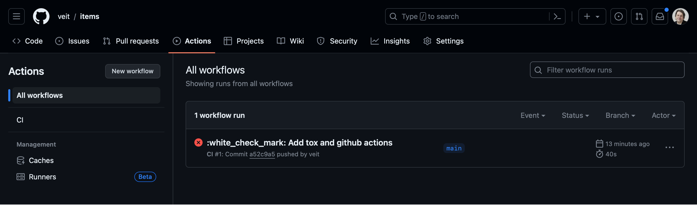
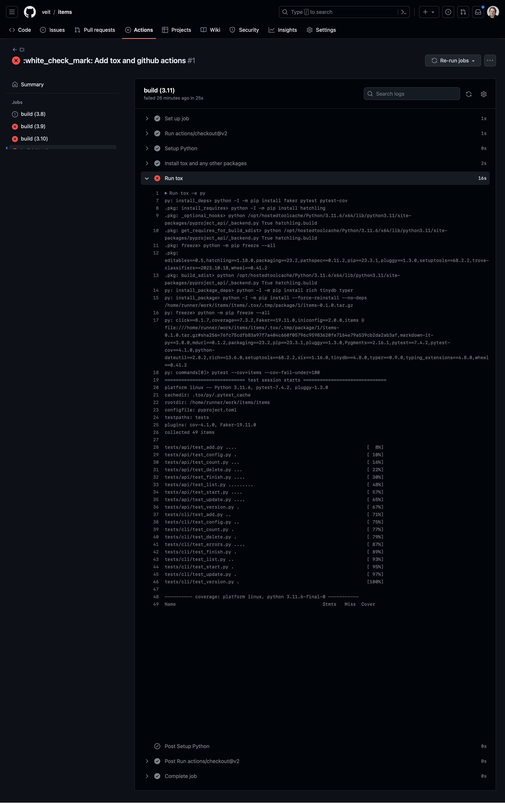

tox
===

`tox <https://tox.readthedocs.io/>`_ is an automation tool that works similarly
to a :term:`CI` tool, but can be run both locally and in conjunction with other
CI tools on a server.

In the following, we will set up tox for our Tasks application so that it helps
us with local testing. We will then set up testing using GitHub Actions.

Introduction to tox
-------------------

tox is a command line tool that allows you to run your complete test suite in
different environments. We will use tox to test the Tasks project in multiple
Python versions, but tox is not limited to Python versions only. You can use it
to test with different dependency configurations and different configurations
for different operating systems. tox uses project information from the
:file:`setup.py` or :file:`pyproject.toml` file for the package under test to
create an installable :doc:`distribution of your package
<../../packs/distribution>`. It searches for a list of environments in the
``[tool.tox]`` section of the :file:`pyproject.toml` file, and then performs the
following steps for each one:

#. creates a :term:`virtual environment <Virtual environment>`
#. installs some dependencies with :term:`pip`
#. build your package
#. install your package with pip
#. run further tests

After all environments have been tested, tox outputs a summary of the results.

To accelerate this process with :term:`uv`, we don’t use tox directly, but
`tox-uv <https://github.com/tox-dev/tox-uv>`_.

Setting up tox
--------------

Previously, tox was usually configured in the :file:`tox.ini` file. However,
since tox 4.44.0, its functionality has been frozen and future configuration
parameters will probably only be provided in a
:doc:`Python4DataScience:data-processing/serialisation-formats/toml/index` file,
for example in the :ref:`pyproject-toml` file. Let’s take a look at a simple
configuration in the :file:`pyproject.toml` file:

.. code-block:: toml

   [tool.tox]
   env_list = ["py315"]

   [tool.tox.env_run_base]
   dependency_groups = [ "tests" ]
   commands = [[ "pytest"]]

In the ``[tool.tox]`` section, we defined ``env_list = ["py315"]``. This is a
shorthand that instructs tox to run our tests using Python version 3.15. We will
add more Python versions shortly, but using one version helps us better
understand how tox works.

In the ``[tool.tox.env_run_base]`` section, ``dependency_groups`` specifies
``tests``. This tells tox that the corresponding libraries should be installed
in this environment. Finally, ``commands`` instructs tox to run ``pytest``.

The configuration for a specific environment could be added using
:samp:`tool.tox.env.{ENV_NAME}`, and the base configuration for packages using
:samp:`tool.tox.env_pkg_base`.

Executing tox
-------------

Before you can run tox, you must ensure that you have installed tox-uv:

.. tab:: Linux/macOS

   .. code-block:: console

      $ uv add --group tests tox-uv

.. tab:: Windows

   .. code-block:: ps1con

      C:> uv add --group tests tox-uv

To run tox, simply start tox:

.. code-block:: pytest

   $ uv run tox
   True: _optional_hooks> python /Users/veit/cusy/prj/cusy.tasks/.venv/lib/python3.15/site-packages/pyproject_api/_backend.py True uv_build
   True: get_requires_for_build_sdist> python /Users/veit/cusy/prj/cusy.tasks/.venv/lib/python3.15/site-packages/pyproject_api/_backend.py True uv_build
   True: build_sdist> python /Users/veit/cusy/prj/cusy.tasks/.venv/lib/python3.15/site-packages/pyproject_api/_backend.py True uv_build
   3.15: install_package> .venv/bin/uv pip install --reinstall --no-deps cusy-tasks@/Users/veit/cusy/prj/cusy.tasks/.tox/.tmp/package/9/cusy_tasks-26.2.0.tar.gz
   3.15: commands[0]> python --version --version
   Python 3.15.0 (main, Oct  9 2026, 11:16:41) [Clang 17.0.0 (clang-1700.6.4.2)]
   3.15: commands[1]> coverage run -m pytest ''
   ============================= test session starts ==============================
   platform darwin -- Python 3.15.0, pytest-9.2.0, pluggy-1.7.0
   cachedir: .tox/3.15/.pytest_cache
   rootdir: /Users/veit/cusy/prj/cusy.tasks
   configfile: pyproject.toml
   plugins: cov-7.1.0, Faker-40.44.0
   collected 83 items

   tests/api/test_add.py ......                                             [  7%]
   tests/api/test_config.py .                                               [  8%]
   tests/api/test_count.py ...                                              [ 12%]
   tests/api/test_delete.py ...                                             [ 15%]
   tests/api/test_delete_all.py ..                                          [ 18%]
   tests/api/test_exceptions.py ..                                          [ 20%]
   tests/api/test_finish.py ....                                            [ 25%]
   tests/api/test_item_id.py .                                              [ 26%]
   tests/api/test_list.py .........                                         [ 37%]
   tests/api/test_list_edge_cases.py ........                               [ 46%]
   tests/api/test_start.py ....                                             [ 51%]
   tests/api/test_task.py ...                                               [ 55%]
   tests/api/test_update.py .....                                           [ 61%]
   tests/api/test_version.py .                                              [ 62%]
   tests/cli/test_add.py ..                                                 [ 65%]
   tests/cli/test_config.py ..                                              [ 67%]
   tests/cli/test_count.py .                                                [ 68%]
   tests/cli/test_delete.py .                                               [ 69%]
   tests/cli/test_errors.py .......                                         [ 78%]
   tests/cli/test_finish.py .                                               [ 79%]
   tests/cli/test_help.py .........                                         [ 90%]
   tests/cli/test_list.py .....                                             [ 96%]
   tests/cli/test_start.py .                                                [ 97%]
   tests/cli/test_update.py .                                               [ 98%]
   tests/cli/test_version.py .                                              [100%]

   ============================== 83 passed in 0.21s ==============================
   True: _exit> python /Users/veit/cusy/prj/cusy.tasks/.venv/lib/python3.15/site-packages/pyproject_api/_backend.py True uv_build
     3.15: OK (0.76=setup[0.15]+cmd[0.01,0.60] seconds)
     congratulations :) (0.79 seconds)

Testing multiple Python versions
--------------------------------

To do this, we extend ``envlist`` in the :file:`pyproject.toml` file to add
further Python versions:

.. code-block:: toml

   [tool.tox]
   env_list = [
     "3.15",
     "3.14",
     "3.13",
     "3.12",
     "3.11",
     "3.13t",
     "3.14t",
     "3.15t",
   ]
   skip_missing_interpreters = true

We will now test Python versions from 3.11 to 3.15. In addition, we have also
added the setting ``skip_missing_interpreters = true`` so that tox does not fail
if one of the listed Python versions is missing on your system. If the value is
set to ``true``, tox will run the tests with every available Python version, but
will skip versions it doesn’t find without failing. The output is very similar,
although I will only highlight the differences in the following illustration:

.. code-block:: pytest
   :emphasize-lines: 3-6, 10-14, 18-22, 26-30, 34-38, 42-46, 50-54, 58-62, 67-

    $ uv run tox
    ...
    3.15: install_package> .venv/bin/uv pip install --reinstall --no-deps cusy-tasks@/Users/veit/cusy/prj/cusy.tasks/.tox/.tmp/package/18/cusy_tasks-26.2.0.tar.gz
    3.15: commands[0]> python --version --version
    Python 3.15.0 (main, Oct  9 2026, 11:16:41) [Clang 17.0.0 (clang-1700.6.4.2)]
    3.15: commands[1]> coverage run -m pytest ''
    ============================= test session starts ==============================
    ...
    ============================== 83 passed in 0.22s ==============================
    3.15: OK ✔ in 0.77 seconds
    3.14: install_package> .venv/bin/uv pip install --reinstall --no-deps cusy-tasks@/Users/veit/cusy/prj/cusy.tasks/.tox/.tmp/package/19/cusy_tasks-26.2.0.tar.gz
    3.14: commands[0]> python --version --version
    Python 3.14.9 (main, Oct 21 2026, 17:47:42) [Clang 23.1.3 ]
    3.14: commands[1]> coverage run -m pytest ''
    ============================= test session starts ==============================
    ...
    ============================== 83 passed in 0.24s ==============================
    3.14: OK ✔ in 0.68 seconds
    3.13: install_package> .venv/bin/uv pip install --reinstall --no-deps cusy-tasks@/Users/veit/cusy/prj/cusy.tasks/.tox/.tmp/package/20/cusy_tasks-26.2.0.tar.gz
    3.13: commands[0]> python --version --version
    Python 3.13.16 (main, Sep 30 2026, 18:57:20) [Clang 17.0.0 (clang-1700.6.4.2)]
    3.13: commands[1]> coverage run -m pytest ''
    ============================= test session starts ==============================
    ...
    ============================== 83 passed in 0.34s ==============================
    3.13: OK ✔ in 0.84 seconds
    3.12: install_package> .venv/bin/uv pip install --reinstall --no-deps cusy-tasks@/Users/veit/cusy/prj/cusy.tasks/.tox/.tmp/package/21/cusy_tasks-26.2.0.tar.gz
    3.12: commands[0]> python --version --version
    Python 3.12.6 (v3.12.6:a4a2d2b0d85, Sep  6 2024, 16:08:03) [Clang 13.0.0 (clang-1300.0.29.30)]
    3.12: commands[1]> coverage run -m pytest ''
    ============================= test session starts ==============================
    ...
    ============================== 83 passed in 0.72s ==============================
    3.12: OK ✔ in 1.33 seconds
    3.11: install_package> .venv/bin/uv pip install --reinstall --no-deps cusy-tasks@/Users/veit/cusy/prj/cusy.tasks/.tox/.tmp/package/22/cusy_tasks-26.2.0.tar.gz
    3.11: commands[0]> python --version --version
    Python 3.11.17 (main, Oct 21 2026, 17:46:23) [Clang 23.1.3 ]
    3.11: commands[1]> coverage run -m pytest ''
    ============================= test session starts ==============================
    ...
    ============================== 83 passed in 0.31s ==============================
    3.11: OK ✔ in 0.71 seconds
    3.13t: install_package> .venv/bin/uv pip install --reinstall --no-deps cusy-tasks@/Users/veit/cusy/prj/cusy.tasks/.tox/.tmp/package/23/cusy_tasks-26.2.0.tar.gz
    3.13t: commands[0]> python --version --version
    Python 3.13.0 experimental free-threading build (main, Oct 16 2024, 08:24:33) [Clang 18.1.8 ]
    3.13t: commands[1]> coverage run -m pytest ''
    ============================= test session starts ==============================
    ...
    ============================== 83 passed in 0.85s ==============================
    3.13t: OK ✔ in 1.56 seconds
    3.14t: install_package> .venv/bin/uv pip install --reinstall --no-deps cusy-tasks@/Users/veit/cusy/prj/cusy.tasks/.tox/.tmp/package/24/cusy_tasks-26.2.0.tar.gz
    3.14t: commands[0]> python --version --version
    Python 3.14.0b4 free-threading build (main, Jul  8 2025, 21:06:49) [Clang 20.1.4 ]
    3.14t: commands[1]> coverage run -m pytest ''
    ============================= test session starts ==============================
    ...
    ============================== 83 passed in 0.25s ==============================
    3.14t: OK ✔ in 0.69 seconds
    3.15t: install_package> .venv/bin/uv pip install --reinstall --no-deps cusy-tasks@/Users/veit/cusy/prj/cusy.tasks/.tox/.tmp/package/25/cusy_tasks-26.2.0.tar.gz
    3.15t: commands[0]> python --version --version
    Python 3.15.0 free-threading build (main, Oct  9 2026, 15:11:36) [Clang 22.1.3 ]
    3.15t: commands[1]> coverage run -m pytest ''
    ============================= test session starts ==============================
    ...
    ============================== 83 passed in 0.21s ==============================
    True: _exit> python /Users/veit/cusy/prj/cusy.tasks/.venv/lib/python3.15/site-packages/pyproject_api/_backend.py True uv_build
      3.15: OK (0.76=setup[0.15]+cmd[0.01,0.60] seconds)
      3.14: OK (0.68=setup[0.07]+cmd[0.01,0.60] seconds)
      3.13: OK (0.84=setup[0.09]+cmd[0.01,0.75] seconds)
      3.12: OK (1.33=setup[0.08]+cmd[0.02,1.23] seconds)
      3.11: OK (0.71=setup[0.07]+cmd[0.01,0.63] seconds)
      3.13t: OK (1.56=setup[0.07]+cmd[0.01,1.47] seconds)
      3.14t: OK (0.69=setup[0.07]+cmd[0.01,0.61] seconds)
      3.15t: OK (0.68=setup[0.08]+cmd[0.01,0.59] seconds)
      congratulations :) (7.28 seconds)

Running Tox environments in parallel
------------------------------------

In the previous example, the different environments were executed one after the
other. It is also possible to run them in parallel with the ``-p`` option:

.. code-block:: pytest

   $ uv run tox -p
   warning: Malware checks are experimental and may change without warning. Pass `--preview-features malware-check` to disable this warning.
   3.15t: OK ✔ in 1.01 seconds
   3.14t: OK ✔ in 1.08 seconds
   3.14: OK ✔ in 1.29 seconds
   3.15: OK ✔ in 1.31 seconds
   3.11: OK ✔ in 1.36 seconds
   3.13: OK ✔ in 1.43 seconds
   3.12: OK ✔ in 1.85 seconds
     3.15: OK (1.31=setup[0.26]+cmd[0.02,1.03] seconds)
     3.14: OK (1.29=setup[0.27]+cmd[0.01,1.01] seconds)
     3.13: OK (1.43=setup[0.29]+cmd[0.02,1.13] seconds)
     3.12: OK (1.85=setup[0.25]+cmd[0.02,1.58] seconds)
     3.11: OK (1.36=setup[0.28]+cmd[0.02,1.06] seconds)
     3.13t: OK (2.19=setup[0.27]+cmd[0.01,1.91] seconds)
     3.14t: OK (1.08=setup[0.22]+cmd[0.01,0.84] seconds)
     3.15t: OK (1.01=setup[0.19]+cmd[0.01,0.81] seconds)
     congratulations :) (2.23 seconds)

.. note::
   The output is not abbreviated; this is the full output you will see if
   everything works.

Add coverage report in tox
--------------------------

The configuration of coverage reports can easily be added to the
:file:`pyproject.toml` file. To do this, we need to add ``pytest-cov`` to the
``tests`` dependency group so that the ``pytest-cov`` plugin is also installed
in the tox test environments. Including ``pytest-cov`` also includes all other
dependencies, such as ``coverage``. We then add
:samp:`env.coverage-report.{OPTIONS}` and change ``env_run_base.commands``:

.. code-block:: toml
   :emphasize-lines: 6, 16-23, 26-

   [dependency-groups]
   ...
   tests = [
     "faker",
     "pytest>=6",
     "pytest-cov",
   ]

   [tool.tox]
   requires = [ "tox>=4" ]
   env_list = [
     "py3{10-14}",
     "py{13-14}t",
   ]
   skip_missing_interpreters = true
   env.coverage-report.description = "Report coverage over all test runs."
   env.coverage-report.deps = [ "coverage[toml]" ]
   env.coverage-report.depends = [ "py" ]
   env.coverage-report.skip_install = true
   env.coverage-report.commands = [
     [ "coverage combine" ],
     [ "coverage report" ],
   ]
   env_run_base.dependency_groups = [ "tests" ]
   env_run_base.deps = [ "coverage[toml]" ]
   env_run_base.commands = [
     [ "coverage", "run", "-m", "pytest" ],
   ]

When using Coverage with ``tox``, it can sometimes be useful to add a section in
the :file:`pyproject.toml` file to tell Coverage which source code paths should
be considered identical:

.. code-block:: toml

   [tool.coverage.paths]
   source = ["src", ".tox/py*/**/site-packages"]

The Tasks source code is initially located in :file:`src/cusy/tasks/` before tox
creates the virtual environments and installs tasks in the environment. It is
then located in :file:`.tox/py315/lib/python3.15/site-packages/cusy.tasks`, for
example.

.. code-block:: console
   :emphasize-lines: 1

   $ uv run tox
   ...
   coverage-report: commands[1]> coverage report
   Name    Stmts   Miss Branch BrPart  Cover   Missing
   ---------------------------------------------------
   TOTAL     365      0     14      0   100%

   29 files skipped due to complete coverage.
     3.15: OK (0.82=setup[0.15]+cmd[0.01,0.65] seconds)
     3.14: OK (0.78=setup[0.07]+cmd[0.01,0.70] seconds)
     3.13: OK (0.92=setup[0.09]+cmd[0.01,0.82] seconds)
     3.12: OK (1.35=setup[0.08]+cmd[0.01,1.26] seconds)
     3.11: OK (0.77=setup[0.08]+cmd[0.01,0.69] seconds)
     3.13t: OK (1.64=setup[0.08]+cmd[0.01,1.55] seconds)
     3.14t: OK (0.82=setup[0.09]+cmd[0.01,0.72] seconds)
     3.15t: OK (0.74=setup[0.08]+cmd[0.01,0.66] seconds)
     coverage-report: OK (0.19=setup[0.00]+cmd[0.09,0.10] seconds)
     congratulations :) (8.07 seconds)

Set minimum coverage
--------------------

When executing coverage by tox, it also makes sense to define a minimum coverage
level in order to recognise any coverage failures. This is achieved with the
``--cov-fail-under`` option:

.. code-block:: console
   :emphasize-lines: 8

   Name               Stmts   Miss Branch BrPart  Cover   Missing
   --------------------------------------------------------------
   src/cusy/tasks/api.py 68      1     12      1    98%   88
   --------------------------------------------------------------
   TOTAL                428      1     32      1    99%

   26 files skipped due to complete coverage.
   Coverage failure: total of 99 is less than fail-under=100

This adds the highlighted line to the output.

.. _posargs:

Passing pytest parameters to tox
--------------------------------

We can also call individual tests with tox by making another change so that
:term:`parameters <Parameter>` can be passed to pytest:

.. code-block:: toml
   :emphasize-lines: 19

   [tool.tox]
   requires = [ "tox>=4" ]
   env_list = [
     "3.15",
     "3.14",
     "3.13",
     "3.12",
     "3.11",
     "3.13t",
     "3.14t",
     "3.15t",
     "coverage-report",
   ]
   skip_missing_interpreters = true
   env_run_base.dependency_groups = [ "tests" ]
   env_run_base.deps = [ "coverage[toml]" ]
   env_run_base.commands = [
     [ "python", "--version", "--version" ],
     [ "coverage", "run", "-m", "pytest", "{posargs}" ],
   ]

To pass arguments to pytest, insert them between the tox arguments and the
pytest arguments. In this case, we select ``test_version`` tests with the ``-k``
keyword option. We also use ``--no-cov`` to disable coverage:

.. code-block:: pytest
   :emphasize-lines: 1, 3

   $ uv run tox -e py315 -- -k test_version --no-cov
   ...
   py315: recreate env because requirements removed: coverage[toml]
   py315: remove tox env folder /Users/veit/cusy/prj/cusy.tasks/.tox/py315
   py315: venv> .venv/bin/uv venv -p cpython3.15 --allow-existing '--prompt=cusy.tasks[py315]' --python-preference system /Users/veit/cusy/prj/cusy.tasks/.tox/py315
   py315: install_dependency-groups> .venv/bin/uv pip install 'coverage[toml]' faker pytest-cov 'pytest>=9'
   True: _optional_hooks> python /Users/veit/cusy/prj/cusy.tasks/.venv/lib/python3.15/site-packages/pyproject_api/_backend.py True uv_build
   True: get_requires_for_build_sdist> python /Users/veit/cusy/prj/cusy.tasks/.venv/lib/python3.15/site-packages/pyproject_api/_backend.py True uv_build
   True: build_sdist> python /Users/veit/cusy/prj/cusy.tasks/.venv/lib/python3.15/site-packages/pyproject_api/_backend.py True uv_build
   py315: install_package_deps> .venv/bin/uv pip install rich 'tinydb<4.9' typer
   py315: install_package> .venv/bin/uv pip install --reinstall --no-deps cusy-tasks@/Users/veit/cusy/prj/cusy.tasks/.tox/.tmp/package/5/cusy_tasks-26.2.0.tar.gz
   py315: commands[0]> python --version --version
   Python 3.15.0 (main, Oct  9 2026, 11:16:41) [Clang 17.0.0 (clang-1700.6.4.2)]
   True: _exit> python /Users/veit/cusy/prj/cusy.tasks/.venv/lib/python3.15/site-packages/pyproject_api/_backend.py True uv_build
     py315: OK (0.58=setup[0.57]+cmd[0.01] seconds)
     congratulations :) (0.61 seconds)

      py314: commands[0]> coverage run -m pytest -k test_version --no-cov
      ============================= test session starts ==============================
      platform darwin -- Python 3.14.0, pytest-8.3.3, pluggy-1.5.0
      cachedir: .tox/py314/.pytest_cache
      rootdir: /Users/veit/cusy/prj/cusy.tasks
      configfile: pyproject.toml
      testpaths: tests
      plugins: cov-5.0.0, anyio-4.6.0, Faker-30.3.0
      collected 49 items / 47 deselected / 2 selected

      tests/api/test_version.py .                                              [ 50%]
      tests/cli/test_version.py .                                              [100%]

      ======================= 2 passed, 47 deselected in 0.07s =======================
      .pkg: _exit> python /Users/veit/cusy/prj/cusy.tasks/.venv/lib/python3.14/site-packages/pyproject_api/_backend.py True hatchling.build
        py314: OK (1.49=setup[0.96]+cmd[0.53] seconds)
        congratulations :) (1.53 seconds)

``tox`` is not only ideal for the local automation of test processes, but also
helps with server-based :term:`CI`. Let’s continue with the execution of pytest
and tox using GitHub actions.

Running ``tox`` with GitHub actions
-----------------------------------

If your project is hosted on `GitHub <https://github.com/>`_, you can use GitHub
actions to automatically run your tests in different environments. A whole range
of environments are available for GitHub actions:
`github.com/actions/virtual-environments
<https://github.com/actions/runner-images?tab=readme-ov-file>`_.

#. To create a GitHub action in your project, click on :menuselection:`Actions
   --> set up a workflow yourself`. This usually creates a
   :file:`.github/workflows/main.yml` file.
#. Give this file a more descriptive name. We usually use :file:`ci.yml` for
   this.
#. The prefilled YAML file is not very helpful for our purposes. You can add a
   ``coverage`` section, for example with:

   .. code-block:: yaml

      jobs:
        coverage:
          name: Ensure 100% test coverage
          runs-on: ubuntu-latest
          needs: tests
          if: always()

          steps:
            - uses: actions/checkout@de0fac2e4500dabe0009e67214ff5f5447ce83dd # v6.0.2
              with:
                persist-credentials: false
            - uses: actions/setup-python@a309ff8b426b58ec0e2a45f0f869d46889d02405 # v6.2.0
              with:
                python-version-file: .python-version
            - uses: hynek/setup-cached-uv@4300ec2180bc77d705e626a34e381b81a4772c51 # v2.5.0

            - name: Download coverage data
              uses: actions/download-artifact@3e5f45b2cfb9172054b4087a40e8e0b5a5461e7c # v8.0.1
              with:
                pattern: coverage-data-*
                merge-multiple: true

            - name: Combine coverage and fail if it’s <100%.
              run: |
                uv tool install coverage

                coverage combine
                coverage html --skip-covered --skip-empty

                # Report and write to summary.
                coverage report --format=markdown >> $GITHUB_STEP_SUMMARY

                # Report again and fail if under 100%.
                coverage report --fail-under=100

   ``name``
       can be any name. It is displayed in the GitHub Actions user interface.
   ``steps``
       is a list of steps. The name of each step can be arbitrary and is
       optional.
   ``uses: actions/checkout``
       is a GitHub actions tool that checks out our repository so that the rest
       of the workflow can access it.
   ``uses: actions/setup-python``
       is a GitHub actions tool that configures Python and installs it in a
       build environment.
   ``with: python-version: ${{ matrix.python }}``
       says that an environment should be created for each of the Python
       versions listed in ``matrix.python``.
   ``uses: hynek/setup-cached-uv``
       uses :term:`uv` in GitHub Actions.

       .. seealso::
          * `setup-cached-uv <https://github.com/hynek/setup-cached-uv>`_

#. You can then click on :guilabel:`Start commit`. As we want to make further
   changes before the tests are executed automatically, we select
   :guilabel:`Create a new branch for this commit and start a pull request` and
   github-actions as the name for the new :term:`branch <branch>`. Finally, you
   can click on :guilabel:`Create pull request`.
#. To switch to the new branch, we go to :menuselection:`Code --> main -->
   github-actions`.

The actions syntax is well documented. A good starting point in the GitHub
Actions documentation is the `Building and Testing Python
<https://docs.github.com/en/actions/use-cases-and-examples/building-and-testing/building-and-testing-python>`__
page. The documentation also shows you how to run pytest directly without tox
and how to extend the matrix to multiple operating systems. As soon as you have
set up your :file:`*.yml` file and uploaded it to your GitHub repository, it
will be executed automatically. You can then see the runs in the
:menuselection:`Actions` tab:

The different Python environments are listed on the left-hand side. If you
select one, the results for this environment are displayed, as shown in the
following screenshot:

.. seealso::
   * `Building and testing Python
     <https://docs.github.com/en/actions/use-cases-and-examples/building-and-testing/building-and-testing-python>`__
   * `Workflow syntax for GitHub Actions
     <https://docs.github.com/en/actions/writing-workflows/workflow-syntax-for-github-actions>`_

Display badge
-------------

Now you can add a badge of your :term:`CI` status to your :file:`README.rst`
file, for example with:

.. code-block:: rest

   .. image:: https://github.com/YOU/YOUR_PROJECT/workflows/CI/badge.svg?branch=main
      :target: https://github.com/YOU/YOUR_PROJECT/actions?workflow=CI
      :alt: CI Status

Publish test coverage
---------------------

You can publish the test coverage on GitHub, see also :ref:`Coverage
GitHub-Actions <coverage-github-actions>`.

Extend tox
----------

tox uses `pluggy <https://pluggy.readthedocs.io/en/stable/>`_ to customise the
default behaviour. Pluggy finds a plugin by searching for an entry point with
the name ``tox``, for example in a :file:`pyproject.toml` file:

.. code-block:: toml

   [project.entry-points.tox]
   my_plugin = "my_plugin.hooks"

To use the plugin, it therefore only needs to be installed in the same
environment in which tox is running and it is found via the defined entry point.

A plugin is created by implementing extension points in the form of hooks. For
example, the following code snippet would define a new ``--my`` :abbr:`CLI
(Command Line Interface)`:

.. code-block:: python

   from tox.config.cli.parser import ToxParser
   from tox.plugin import impl

   @impl
   def tox_add_option(parser: ToxParser) -> None:
       parser.add_argument("--my", action="store_true", help="my option")

.. seealso::
   * `Extending tox <https://tox.wiki/en/latest/plugins.html>`_
   * `tox development team <https://github.com/orgs/tox-dev/repositories>`_

.. _tox_uv:

``tox-uv``
----------

`tox-uv <https://pypi.org/project/tox-uv/>`_ is a Tox plugin that replaces
:term:`virtualenv` and :term:`pip` with :term:`uv` in your Tox environments.

You can install ``tox`` and ``tox-uv`` with:

.. code-block:: console

   $ uv tool install tox --with tox-uv

:file:`uv.lock` support
~~~~~~~~~~~~~~~~~~~~~~~

If you want to use ``uv sync`` with a :file:`uv.lock` file for a Tox
environment, you must change the runner for this Tox environment to
``uv-venv-lock-runner``, for example:

.. code-block:: toml
   :caption: pyproject.toml

   env.app.dependency_groups = [ "tests" ]
   env.app.runner = "uv-venv-lock-runner"
   commands = [[ "pytest"]]

The ``app`` environment uses the ``uv-venv-lock-runner`` and utilises ``uv sync
--locked`` to install the dependencies in the versions specified in the
:file:`uv.lock` file.

.. seealso::
   * `uv.lock support
     <https://github.com/tox-dev/tox-uv?tab=readme-ov-file#uvlock-support>`_
